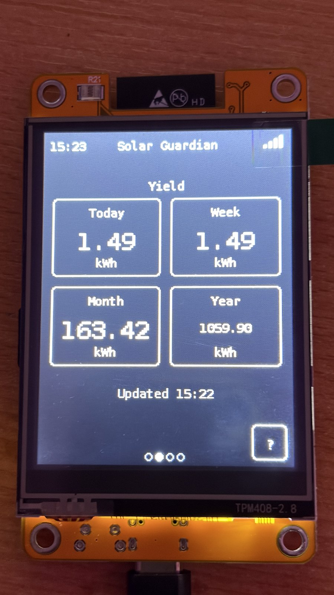

# Solar Guardian CYD

A solar dashboard for the Solar Guardian (EPEVER) cloud, running on an
ESP32 "Cheap Yellow Display" (CYD, ESP32-2432S028, 2.8" touch TFT).

[🇩🇪 Deutsch](#deutsch) | [🇬🇧 English](#english)

---

## Deutsch

Ein Solar-Dashboard für die Solar-Guardian-Cloud (EPEVER) auf einem ESP32
"Cheap Yellow Display" (CYD, ESP32-2432S028, 2,8" Touch-TFT). Es zeigt die
wichtigsten Werte der Solaranlage sowohl direkt am Gerät als auch im
Browser und führt dabei ein eigenes Ertragsbuch mit Verlauf und Backup.

> **Getestet mit:** EPEVER Tracer-AN (MPPT-Laderegler), angebunden über
> das Cloud-Gateway der Solar-Guardian-Plattform. Andere Reglermodelle
> der Plattform sind nicht getestet - sie können funktionieren, wenn sie
> dieselben Messwerte liefern, das ist aber nicht sicher. Wer die App mit
> einem anderen Modell ausprobiert, ist herzlich eingeladen, die
> Erfahrung als [Issue auf GitHub](https://github.com/Eiswolf-BG/Solar-Guardian-CYD/issues)
> zu teilen.

### Highlights

- Acht Wisch-Seiten am Gerät: Übersicht, PV-Status, Batterie, Leistung,
  Tagesverlauf, Ertrag, Verlauf und Wetter.
- Kacheln auf der Übersicht und den Detailseiten lassen sich antippen,
  um frische Werte direkt vom Solarregler abzurufen.
- Ertragsbuch mit Tages-, Monats- und Jahreswerten, täglichem Backup auf
  der SD-Karte und manueller Korrekturmöglichkeit.
- Web-Ansicht mit allen Werten und einer animierten Haus-Grafik, die den
  Weg der Solarenergie zeigt.
- Nachtmodus mit reduzierter Abfragefrequenz und eigener Mondsichel-
  Anzeige.
- Automatische Standortermittlung für eine Wetterkachel mit aktuellem
  Wetter und Wochenvorschau.

### Funktionen am Gerät

#### Übersicht

Die erste Seite nach dem Booten zeigt vier Kacheln auf einen Blick:
Wetter (Symbol und aktuelle Temperatur, antippen öffnet die
[Wochenansicht](#standort-und-wetter)), aktuelle Leistung, heutiger
Ertrag und Batterie (Spannung, ein Füllstandssymbol in
Autobatterie-Optik, das je nach Ladezustand die Farbe wechselt -
grün/gelb/rot -, sowie der Ladezustand in Prozent). Leistung, Ertrag und
Batterie antippen fragt die Werte sofort beim Solarregler ab; die Kachel zeigt dabei
kurz "Lade..." und danach wieder ihre normale Beschriftung, ohne dass
sich die Seite selbst ändert. Die Wetterkachel öffnet immer die
Wochenansicht.

#### Wisch-Seiten

Von der Übersicht aus wischt man durch die weiteren Seiten, in dieser
Reihenfolge:

- **PV-Status**: PV-Spannung, PV-Strom, PV-Leistung und das heutige
  Leistungsmaximum.
- **Batterie**: Ladezustand, Spannung, Strom, Temperatur, Ladestatus mit
  kurzer Erklärung der vier Zustände, sowie die höchste und tiefste
  Batteriespannung des Tages.
- **Leistung**: die aktuelle PV-Leistung groß im Blick, PV-Spannung und
  -Strom als Kacheln, dazu eine Kurve der letzten drei Stunden.
- **Tagesverlauf**: die Leistungskurve des ganzen Tages von 05:00 bis
  22:00 Uhr mit dem Tages-Höchstwert in Watt und einem Fortschrittsbalken,
  der sich über den Tag füllt.
- **Ertrag**: Heute, Woche als gleitendes 7-Tage-Fenster, Monat und Jahr.
- **Verlauf**: drei antippbare Reiter Tage, Monate und Jahre, jeweils als
  Balkengrafik der letzten 7 Tage, Monate bzw. Kalenderjahre.
- **Wetter**: eine Wochenvorschau mit Wochentag, Wettersymbol sowie
  Höchst- und Tiefsttemperatur pro Tag - dieselben Daten wie in der
  Web-Ansicht.

Kacheln auf den Seiten Leistung, Ertrag, Batterie und PV-Status lassen
sich ebenfalls antippen, um sofort frische Werte abzurufen.

#### Nachtmodus

Die Abfrage läuft zwischen 04:30 und 22:30 Uhr, danach folgt eine
Abschlussabfrage, die per Abgleich mit dem Tages-Backup bestätigt wird.
Sobald das bestätigt ist, erscheint im Kopfbereich eine kleine
Mondsichel, bis die Abfrage um 04:30 Uhr wieder beginnt - unabhängig von
der gewählten Systemfarbe ist sie immer weiß. Die Batteriewerte werden
in dieser Zeit trotzdem alle 10 Minuten aktualisiert, und eine
Batterie-Kachel lässt sich auch nachts antippen, um sofort frische Werte
abzurufen. Andere Kacheln (Leistung, Ertrag) bleiben nachts gesperrt;
ein Tipp darauf zeigt einen Hinweis, dass die Aktualisierung erst wieder
ab 04:30 Uhr möglich ist.

#### Anzeige und Bedienung

Beschriftungen, Einheiten (kWh, W, V, A, %, °C), Rahmen sowie
Kurven/Balken erscheinen in der im Menü gewählten Systemfarbe. Alle vom
Portal oder Wetterdienst abgefragten Werte - Zahlen und Texte, z.B.
Leistung, Spannung, Ertrag, Temperatur, Ladestatus - erscheinen
systemweit in einer zweiten, gedämpften Farbe, ebenso das
Diagramm-Raster und die Wochentage, Monatsnamen und Jahreszahlen in den
Übersichten. Die Helligkeit der Hintergrundbeleuchtung lässt sich im
Menü stufenlos einstellen, die Sprache ist auf Deutsch oder Englisch
umstellbar. Beim Start erscheint für 7 Sekunden ein Startlogo. Tippen
auf das WLAN-Symbol im Kopfbereich öffnet direkt die Netzwerk-Übersicht.
Die Statuszeile zeigt bei älteren Werten das Datenalter an (z.B.
"Portaldaten 12 Min alt") und bricht bei Bedarf in zwei Zeilen um.

#### Menü

Im Menü stehen: Netzwerke (bis zu 3 WLANs), Konto (Benutzername,
Passwort, Geräte-Seriennummer), Systemfarbe, Helligkeit, Sprache,
Ertragswerte (Monat/Jahr manuell korrigieren), Dateien (Dateiexplorer
für die SD-Karte) und Zurücksetzen. Der Standort für die Wetterkachel
wird automatisch ermittelt und hat deshalb keinen eigenen Menüpunkt.

#### Ersteinrichtung am Gerät

Direkt am Gerät durchlaufen: Touch-Kalibrierung, WLAN-Auswahl und die
Eingabe der Solar-Guardian-Zugangsdaten. Die Geräte-Seriennummer wird
nach der Anmeldung automatisch vom Solar-Guardian-Portal ermittelt - nur
bei Problemen oder mehreren Geräten muss sie von Hand im Menü unter
"Konto" eingetragen werden.

### Ertragsbuch und Daten

Das Ertragsbuch zählt Woche, Monat und Jahr selbst, da die
Portal-Summen bekanntermaßen Lücken haben. Jeder Tag wird zusätzlich
täglich auf der SD-Karte im Ordner `/SolarHistory` gesichert; dieser
Ordner enthält alle Solardaten und bleibt bei einem Zurücksetzen
erhalten - nur die Einstellungen werden dabei gelöscht. Die Werte lassen
sich im Menü unter "Ertragswerte" manuell korrigieren, und ein eigener
Dateiexplorer im Menü zeigt die Dateien auf der SD-Karte.

### Web-Ansicht

Im Menü unter "Netzwerke" → "WebUI" steht die Adresse, die sich im
Browser eines Geräts im selben WLAN öffnen lässt. Sie zeigt alle Werte
groß und aufgeräumt auf Handy oder PC, mit eigenen Reitern für:

- **Übersicht**: Leistung, Heute, Batterie und Batteriespannung.
- **Leistung**
- **Tagesverlauf**
- **Ertrag**
- **Batterie**
- **PV-Status**
- **Verlauf** (Tage/Monate/Jahre)
- **Wetter** (inklusive Wettersymbolen und Leistungskurve)
- **Daten**: Dateien auf der SD-Karte ansehen, herunterladen, bearbeiten
  und löschen, einzeln oder als ZIP für einen ganzen Ordner. Ein Knopf
  "Backup erstellen" sichert Einstellungen und Solardaten zusammen in
  einer ZIP-Datei. Der Ordner `/SolarHistory` steht hier zum Schutz der
  Solardaten nur zum Ansehen und Herunterladen bereit.

Eine kleine Statuszeile unten zeigt Version, Verbindung zum Gerät und
Portal-Status.

#### Animierte Haus-Grafik

Unterhalb der Werte zeigt die Web-Ansicht auf allen Reitern außer Wetter
und Daten eine animierte Haus-Grafik mit dem Weg der Solarenergie. Bei
Tag zeigt sie eine Tagesansicht, bei Nacht eine Nachtansicht - der
Wechsel erfolgt zum tatsächlichen Sonnenauf- und -untergang des
Standorts. Die Stromleitungen sind als leuchtende Schläuche
dargestellt, auf denen ein blaues Lauflicht läuft, solange die Anlage
Ertrag liefert - je mehr Leistung, desto schneller. Nachts läuft ein
ruhiges, gleichmäßiges Lauflicht. Bei Regen oder Schnee in der Region
zeigt die Grafik eine passende Regen- oder Schneeanimation.

### Standort und Wetter

Wetterdaten: [MET Norway](https://api.met.no/) (CC BY 4.0) für das
aktuelle Wetter (Temperatur und Symbol), [Open-Meteo.com](https://open-meteo.com/)
(CC BY 4.0) für die Wochenvorhersage, die Standortsuche und als
Rückfall - beide kostenlos und ohne Zugangsschlüssel. Der Standort wird
automatisch über die öffentliche IP-Adresse des Geräts ermittelt (dabei
geht die IP-Adresse an den jeweiligen Ermittlungsdienst; die
Genauigkeit liegt nur auf Stadt-Ebene, nicht auf die genaue Adresse).
Für einen anderen Standort: die Wetterkachel auf der Übersicht lange
gedrückt halten - dort lässt sich der Standort von Hand per Ortsname
oder Postleitzahl setzen (die Suche zeigt eine antippbare Trefferliste
zur Auswahl, auch bei nur einem Treffer) oder die automatische
Ermittlung erneut anstoßen. Ein von Hand gesetzter Standort bleibt
dauerhaft erhalten. Ohne erkannten Standort zeigt die Wetterkachel
"Standort wählen" statt eines Symbols. Das Wetter aktualisiert sich
alle 30 Minuten, dazu sofort nach dem WLAN-Verbinden und nach einer
Standortänderung. Bleibt das Wetter einmal aus, kann einer der beiden
Dienste gerade nicht erreichbar sein - der aktuelle Status lässt sich
auf den Status-Seiten von [MET Norway](https://status.met.no/) und
[Open-Meteo](https://status.open-meteo.com/) prüfen.

### Zuverlässigkeit

Jede Netzwerk-Abfrage ist mit einem Zeitlimit abgesichert, sodass eine
hängende Verbindung nie unbegrenzt blockiert. Ein eigener Wächter
erkennt, falls der Hintergrund-Abgleich trotzdem einmal länger als
nötig steht, und startet das Gerät dann kontrolliert neu, ohne dabei
gesicherte Ertragsdaten zu verlieren. Bleibt das Problem bestehen,
versucht das Gerät es höchstens noch einmal pro Stunde weiter, statt für
immer aufzugeben. Die Anzeige selbst bleibt davon immer unberührt und
bedienbar.

### Installation

1. SD-Karte (FAT32-formatiert) ins Gerät einlegen - wird für die
   Konfiguration und das Ertragsbuch benötigt.
2. Firmware über den [Web-Flasher](https://eiswolf-bg.github.io/Solar-Guardian-CYD/)
   installieren (Chrome, Edge oder Opera, USB-Kabel). Dort lassen sich
   die letzten drei Versionen auswählen.
3. Beim ersten Start: Touch kalibrieren, WLAN auswählen, Solar-Guardian-
   E-Mail und Passwort eingeben.

**Treiber-Hinweis:** Erkennt der Computer das Gerät nicht (kein USB/COM-
Port sichtbar), wird meist ein Treiber für den CH340-USB-Chip benötigt:
[Windows](https://www.wch-ic.com/downloads/CH341SER_EXE.html) ·
[macOS](https://www.wch-ic.com/downloads/CH341SER_MAC_ZIP.html) · unter
Linux meist bereits im Kernel enthalten.

### Hinweis

Dies ist eine inoffizielle Schnittstelle zur Solar-Guardian-Cloud (EPEVER)
- es besteht keine Verbindung zu oder Zusammenarbeit mit EPEVER, und die
Schnittstelle kann sich jederzeit ändern. Die Zugangsdaten liegen im
Klartext auf der SD-Karte (`/SolarGuardian/config.json`), wie es für ein
privates Gerät ohne weitere Absicherung üblich ist. Mit welchem
Reglermodell getestet wurde, steht oben unter "Getestet mit".

### Anpassen

Die Geräte-Seriennummer lässt sich jederzeit im Menü unter "Konto" auf
dem Feld "Seriennummer" bearbeiten. Sie landet in `device_no` in
`/SolarGuardian/config.json` auf der SD-Karte. Man findet sie im
Solar-Guardian-Portal auf der Geräteseite; die Adresszeile dort enthält
`devid=` gefolgt von der Seriennummer. Die Startwerte für den Reiter
"Jahre" (Vorjahresertrag) stehen in `years.json` im Ordner
`/SolarHistory` auf der SD-Karte und können dort direkt angepasst
werden.

### Galerie

Weitere Fotos: [docs/gallery.md](docs/gallery.md)

### Lizenz

MIT, siehe [LICENSE](LICENSE).

### Selbst bauen

Projekt mit [PlatformIO](https://platformio.org/) öffnen
(`platform = espressif32`, `board = esp32dev`, `framework = arduino`) und
bauen/flashen.

---

## English

A solar dashboard for the Solar Guardian (EPEVER) cloud, running on an
ESP32 "Cheap Yellow Display" (CYD, ESP32-2432S028, 2.8" touch TFT). It
shows the key values of a solar installation both directly on the
device and in a browser, and keeps its own yield log with history and
backup.

> **Tested with:** EPEVER Tracer-AN (MPPT charge controller), connected
> through the Solar Guardian platform's cloud gateway. Other controller
> models on the platform haven't been tested - they may work if they
> report the same values, but that isn't guaranteed. Anyone who tries
> the app with a different model is warmly invited to share their
> experience as an [issue on GitHub](https://github.com/Eiswolf-BG/Solar-Guardian-CYD/issues).

### Highlights

- Eight swipe pages on the device: Overview, PV status, Battery, Power,
  Daily curve, Yield, History, and Weather.
- Tiles on the Overview and the detail pages can be tapped to fetch
  fresh values directly from the solar controller.
- Yield log with daily, monthly, and yearly totals, a daily backup on
  the SD card, and manual correction.
- Web view with all values plus an animated house graphic showing the
  path of the solar energy.
- Night mode with a reduced fetch rate and its own crescent moon
  indicator.
- Automatic location detection for a weather tile with current weather
  and a week-ahead forecast.

### Features on the device

#### Overview

The first page after boot shows four tiles at a glance: weather (icon
and current temperature, tap to open the
[week view](#location-and-weather)), current power output, today's
yield, and battery (voltage, a fill-level icon styled as a car battery
that changes color by charge level - green/yellow/red -, and the charge
level in percent). Tapping Power, Yield, or Battery refreshes those
values immediately; the tile briefly shows "Loading..." and then
returns to its normal label, without switching the page itself. The
weather tile always opens the week view.

#### Swipe pages

From the Overview, swiping moves through the remaining pages, in this
order:

- **PV status**: PV voltage, PV current, PV power, and today's power
  peak.
- **Battery**: charge level, voltage, current, temperature, charging
  status with a short explanation of all four states, plus the day's
  highest and lowest battery voltage.
- **Power**: current PV power front and center, PV voltage/current as
  tiles, plus a chart of the last three hours.
- **Daily curve**: the power curve of the whole day from 05:00 to
  22:00, with today's peak value in watts and a progress bar that fills
  up over the day.
- **Yield**: Today, Week as a rolling 7-day window, Month, and Year.
- **History**: three tappable tabs Days, Months, and Years, each a bar
  chart of the last 7 days, months, or calendar years.
- **Weather**: a week-ahead view with weekday, weather icon, and
  high/low temperature per day - the same data as in the web view.

Tiles on the Power, Yield, Battery, and PV status pages can also be
tapped to fetch fresh values immediately.

#### Night mode

Fetching runs between 04:30 and 22:30, followed by a final query that
is confirmed by comparing it against the day's backup. Once confirmed,
a small crescent moon appears in the header until fetching resumes at
04:30 - it's always white, regardless of the chosen theme color.
Battery values keep refreshing every 10 minutes during this time, and a
battery tile can still be tapped at night for an immediate readout.
Other tiles (Power, Yield) remain locked overnight; tapping one shows a
hint that refreshing is only possible again starting at 04:30.

#### Display and operation

Labels, units (kWh, W, V, A, %, °C), borders, and chart curves/bars use
the theme color chosen in the menu. Every value fetched from the portal
or weather service - numbers and text alike, e.g. power, voltage,
yield, temperature, charging status - appears system-wide in a second,
dimmed color, along with the chart grid and the weekdays, month names,
and years shown in the overviews. Backlight brightness is steplessly
adjustable in the menu, and the language can be switched between German
and English. A boot logo is shown for 7 seconds on every start. Tapping
the WiFi icon in the header opens the network overview directly. The
status line shows the data age for older values (e.g. "Portal data 12
min old"), wrapping to two lines when needed.

#### Menu

The menu offers: Networks (up to 3 WiFi networks), Account (username,
password, device serial number), Theme color, Brightness, Language,
Yield values (manually correct month/year), Files (an SD card file
explorer), and Factory reset. The location used for the weather tile is
detected automatically and has no menu entry of its own.

#### First-time setup on the device

Directly on the device, in order: touch calibration, WiFi selection,
and entering the Solar Guardian account details. The device serial
number is fetched automatically from the Solar Guardian portal after
login - only in case of problems or multiple devices does it need to be
entered by hand in the menu under "Account".

### Yield log and data

The yield log counts week, month, and year itself, since the portal's
own totals are known to have gaps. Each day is also backed up daily on
the SD card in the `/SolarHistory` folder; this folder holds all solar
data and survives a factory reset - only the settings get deleted. The
values can be manually corrected in the menu under "Yield values", and
a file explorer in the menu shows the files on the SD card.

### Web view

In the menu under "Networks" → "WebUI" you'll find the address to open
in a browser on a device in the same WiFi network. It shows all values
large and clean on your phone or PC, with its own tabs for:

- **Overview**: Power, Today, Battery, and battery voltage.
- **Power**
- **Daily curve**
- **Yield**
- **Battery**
- **PV status**
- **History** (Days/Months/Years)
- **Weather** (including weather icons and the power chart)
- **Data**: view, download, edit, and delete files on the SD card,
  individually or as a ZIP for a whole folder. A "Create backup" button
  saves settings and solar data together in one ZIP file. The
  `/SolarHistory` folder stays view-and-download-only here to protect
  your solar data.

A small status line at the bottom shows the version, the connection to
the device, and the portal status.

#### Animated house graphic

Below the values, the web view shows an animated house graphic on every
tab except Weather and Data, illustrating the path of the solar energy.
It shows a daytime scene during the day and a nighttime scene at night,
switching at the location's actual sunrise and sunset. The power lines
are drawn as glowing tubes with a blue light running along them
whenever the system is producing power - the more power, the faster it
runs. At night, a calm, steady light keeps running. When it's raining
or snowing in the area, the graphic shows a matching rain or snow
animation.

### Location and weather

Weather data: [MET Norway](https://api.met.no/) (CC BY 4.0) for the
current weather (temperature and icon), [Open-Meteo.com](https://open-meteo.com/)
(CC BY 4.0) for the weekly forecast, location search, and as a
fallback - both free, no API key required. The location is detected
automatically from the device's public IP address (this sends the IP
address to the detection service; accuracy is only city-level, not an
exact address). For a different location: press and hold the weather
tile on the Overview - there you can set the location by hand (place
name or postal code; the search shows a tappable list of matches to
pick from, even with just one result) or trigger automatic detection
again. A manually set location is kept permanently. Without a detected
location, the weather tile shows "Set location" instead of an icon.
The weather refreshes every 30 minutes, plus immediately after
connecting to WiFi and after a location change. If the weather is
ever missing, one of the two services may currently be unreachable -
their current status can be checked on the status pages of
[MET Norway](https://status.met.no/) and [Open-Meteo](https://status.open-meteo.com/).

### Reliability

Every network request is protected by a timeout, so a hanging
connection never blocks indefinitely. A separate watchdog detects if the
background sync still stays stuck longer than it should and restarts
the device in a controlled way, without ever losing saved yield data.
If the problem persists, the device falls back to trying at most once
an hour instead of giving up forever. The display itself is never
affected and stays fully usable.

### Installation

1. Insert a FAT32-formatted SD card into the device - needed for
   configuration and the yield log.
2. Install the firmware via the [Web Flasher](https://eiswolf-bg.github.io/Solar-Guardian-CYD/)
   (Chrome, Edge, or Opera, USB cable). The last three versions are
   selectable there.
3. On first boot: calibrate touch, select WiFi, enter your Solar Guardian
   email and password.

**Driver note:** If your computer doesn't detect the device (no USB/COM
port shows up), you likely need a driver for the board's CH340 USB chip:
[Windows](https://www.wch-ic.com/downloads/CH341SER_EXE.html) ·
[macOS](https://www.wch-ic.com/downloads/CH341SER_MAC_ZIP.html) · usually
built into the kernel on Linux already.

### Note

This is an unofficial interface to the Solar Guardian (EPEVER) cloud -
there is no affiliation with or endorsement by EPEVER, and the interface
may change at any time. Account details are stored in plain text on the
SD card (`/SolarGuardian/config.json`), as is typical for a private
device without further hardening. The controller model used for
testing is listed above under "Tested with".

### Customizing

The device serial number can be edited any time in the menu under
"Account", on the "Serial number" field. It ends up in `device_no` in
`/SolarGuardian/config.json` on the SD card. You can find it on the
device page in the Solar Guardian portal; its address bar contains
`devid=` followed by the serial number. The seed values for the "Years"
tab (previous years' yield) live in `years.json` in the `/SolarHistory`
folder on the SD card and can be edited there directly.

### Gallery

More photos: [docs/gallery.md](docs/gallery.md)

### License

MIT, see [LICENSE](LICENSE).

### Build it yourself

Open the project with [PlatformIO](https://platformio.org/)
(`platform = espressif32`, `board = esp32dev`, `framework = arduino`) and
build/flash.
