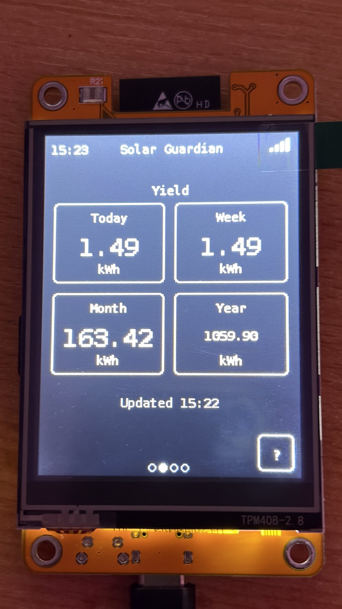

# Solar Guardian CYD

A solar dashboard for the Solar Guardian (EPEVER) cloud, running on an
ESP32 "Cheap Yellow Display" (CYD, ESP32-2432S028, 2.8" touch TFT).

[🇩🇪 Deutsch](#deutsch) | [🇬🇧 English](#english)

---

## Deutsch

Ein Solar-Dashboard für die Solar-Guardian-Cloud (EPEVER) auf einem ESP32
"Cheap Yellow Display" (CYD, ESP32-2432S028, 2,8" Touch-TFT).

### Funktionen

- **Übersicht** (erste Seite nach dem Booten): vier Kacheln auf einen
  Blick - Wetter (Symbol + aktuelle Temperatur, antippen öffnet die
  [Wochenansicht](#standort-und-wetter)), aktuelle Leistung, heutiger
  Ertrag und Batterie-Ladezustand (mit Füllstandssymbol, grün/gelb/rot).
  Leistung/Ertrag/Batterie antippen fragt die Werte sofort neu ab - die
  Kachel zeigt dabei kurz "Lade..." und danach wieder ihre normale
  Beschriftung, die Seite selbst wird dadurch nicht gewechselt (zu den
  Wisch-Seiten gelangt man weiterhin per Wischen). Die Wetterkachel
  verhält sich unverändert und öffnet immer die Wochenansicht. Auf den
  Seiten Leistung, Ertrag, Batterie und PV-Status löst Antippen einer
  Kachel ebenfalls eine sofortige Neuabfrage mit derselben
  "Lade..."-Rückmeldung aus.
- **Wisch-Seiten**: Leistung (aktuelle PV-Leistung groß, PV-Spannung/
  -Strom als Kacheln, Kurve der letzten 3 Stunden), Tagesverlauf
  (Leistungskurve des ganzen Tages von 05:00 bis 22:00 Uhr mit dem
  Tages-Höchstwert in Watt, darunter ein Fortschrittsbalken, der sich
  über den Tag füllt), Ertrag (Heute, Woche als gleitendes
  7-Tage-Fenster, Monat, Jahr), Batterie (Ladezustand, Spannung, Strom,
  Temperatur, Ladestatus mit kurzer Erklärung der vier Zustände, sowie
  die tatsächlichen Höchst-/Tiefstwerte der Batteriespannung des Tages),
  PV-Status (PV-Spannung, PV-Strom, PV-Leistung und das heutige
  Leistungsmaximum als eigene Seite nach Batterie) und als letzte Seite
  Verlauf (drei antippbare Reiter Tage/Monate/Jahre, je eine
  Balkengrafik der letzten 7 Tage, Monate bzw. Kalenderjahre).
- **Aktuellere Werte**: Die Werte auf dem CYD waren bisher bis zu etwa
  30 Minuten alt. Jetzt werden die jeweils neuesten Werte angezeigt
  (in der Regel ca. 1-2 Minuten alt).
- **Echtes Auslesen beim Antippen**: Antippen einer Kachel liest jetzt
  echte, frische Werte direkt vom Regler ab (nur ein Lesebefehl, kein
  Schreibzugriff) - jede dieser Auslesungen steht im Operationsprotokoll
  des Portals. Kacheln für Ertragswerte aktualisieren weiterhin nur über
  den normalen Abruf.
- **Batterie auch nachts**: Die Batteriewerte werden nachts alle 10
  Minuten aktualisiert (nur die Anzeige, die Ertragsdaten bleiben davon
  unberührt). Die Statuszeile auf der Batterie-Seite zeigt dabei den
  Zeitpunkt der nächsten Abfrage.
- **Robustere Rückmeldung beim Antippen**: "Lade..." und danach wieder
  die normale Beschriftung - kein Hängenbleiben, kein Flackern. Der
  Hinweis im Nachtmodus bleibt dabei länger stehen.
- **Nachtmodus**: Die Abfrage läuft nur noch zwischen 04:30 und
  22:30 Uhr - danach eine Abschlussabfrage, bestätigt per Abgleich mit
  dem Tages-Backup. Bestätigt erscheint im Kopfbereich eine kleine
  Mondsichel, bis die Abfrage um 04:30 Uhr wieder beginnt. Tippt man
  nachts trotzdem auf eine Kachel, zeigt die Rückmeldung einen Hinweis,
  dass die Aktualisierung erst wieder ab 04:30 Uhr möglich ist.
- **Datenalter statt "veraltet"**: Die Statuszeile zeigt bei älteren
  Werten jetzt z.B. "Portaldaten 12 Min alt" an statt nur "veraltet" -
  bricht bei Bedarf in zwei Zeilen um, statt abgeschnitten zu werden.
- **Einheitliche Farben** auf allen Seiten: Beschriftungen, Einheiten
  (kWh, W, V, A, %, °C), Rahmen und Kurven/Balken in der gewählten
  Systemfarbe. Alle vom Portal oder Wetterdienst abgefragten Werte -
  Zahlen UND Texte, z.B. Leistung, Spannung, Ertrag, Temperatur,
  Ladestatus - erscheinen systemweit in einer zweiten, gedämpften Farbe,
  ebenso das Diagramm-Raster und die Wochentage/Monatsnamen/Jahreszahlen
  in den Übersichten.
- **Ertragsbuch**: zählt Woche/Monat/Jahr selbst (die Portal-Summen
  haben bekanntermaßen Lücken), mit täglichem Backup im Ordner
  `/SolarHistory` im SD-Karten-Root und manueller Korrekturmöglichkeit.
  Dieser Ordner enthält alle Solardaten und bleibt bei einem
  Zurücksetzen erhalten - nur die Einstellungen werden dabei gelöscht.
- **Web-Ansicht**: Im Menü unter "Netzwerke" → "WebUI" steht die Adresse,
  die sich im Browser eines Geräts im selben WLAN öffnen lässt - zeigt
  alle Werte groß und aufgeräumt auf Handy oder PC, mit eigenen Tabs für
  Übersicht, Leistung, Tagesverlauf, Ertrag, Batterie, PV-Status, Verlauf
  (Tage/Monate/Jahre), Wetter (inklusive Wettersymbolen und
  Leistungskurve) und Daten (Dateien auf der SD-Karte ansehen, herunterladen,
  bearbeiten und löschen, inklusive des Ordners `/SolarHistory` - der
  bleibt dort zum Schutz der Solardaten nur zum Ansehen und
  Herunterladen) - genau wie am Gerät. Im Reiter "Daten" lässt sich
  jede Datei einzeln oder ein ganzer Ordner als ZIP herunterladen, und
  ein Knopf "Backup erstellen" sichert Einstellungen und Solardaten
  zusammen in einer ZIP-Datei. Jetzt auch erreichbar, während am Gerät
  selbst die WebUI-Seite (oder eine andere Vollbild-Seite) geöffnet
  ist. Eine kleine Statuszeile unten zeigt Version, Verbindung zum
  Gerät und Portal-Status. Der Tagesverlauf hat einen
  Fortschrittsbalken unter der stündlichen Zeitachse, die
  Balkengrafiken (Tage/Monate/Jahre) zeigen die Höhe jetzt korrekt
  proportional zum Wert, und die Tage-Ansicht zeigt den genauen
  Tagesertrag mit zwei Nachkommastellen in richtiger, lückenloser
  Reihenfolge.
- **Startlogo** "Sonne im Schild", erscheint 7 Sekunden bei jedem Start.
- **Helligkeit** der Hintergrundbeleuchtung stufenlos einstellbar im Menü.
- Tippen auf das WLAN-Symbol im Kopfbereich öffnet direkt "Netzwerke".
- **Geräte-Seriennummer wird automatisch** nach dem Login vom
  Solar-Guardian-Portal geholt - man muss sie nicht mehr eintippen,
  außer bei Problemen oder mehreren Geräten.
- **Genaueres Wetter**: Das aktuelle Wetter (Temperatur und Symbol) kommt
  jetzt von MET Norway, Open-Meteo bleibt als Rückfall, falls MET Norway
  nicht erreichbar ist.
- **Dateiexplorer** im Menü unter "Dateien": Dateien auf der SD-Karte
  ansehen und einzeln löschen (mit Rückfrage).
- **Empfindliche, zuverlässige Bedienung**: flackerfreie Anzeige, keine
  abgeschnittenen Texte, feinfühlige Wisch-Gesten zwischen den Seiten,
  saubere Anzeige beim Öffnen und Verlassen von Vollbild-Bildschirmen.
- **Absicherung**: Zeitlimit für jede Netzwerk-Abfrage, ein Wächter gegen
  hängenbleibende Hintergrund-Abgleiche mit kontrolliertem Neustart (gibt
  danach nicht für immer auf, sondern versucht es nötigenfalls stündlich
  weiter), sichere Schreibzugriffe auf die SD-Karte.
- **Menü**: Konto (Benutzername, Passwort, Geräte-Seriennummer - wird
  normalerweise automatisch geholt), Netzwerke (bis zu 3 WLANs),
  Systemfarbe, Sprache (Deutsch/Englisch), Ertragswerte (Monat/Jahr
  manuell korrigieren), Dateien, Zurücksetzen. Der Standort für die
  Wetterkachel wird automatisch ermittelt und hat deshalb keinen
  eigenen Menüpunkt.
- **Ersteinrichtung** direkt am Gerät: Touch-Kalibrierung, WLAN-Auswahl,
  Solar-Guardian-Zugangsdaten - die Geräte-Seriennummer wird danach
  automatisch vom Portal geholt.

### Installation

1. SD-Karte (FAT32-formatiert) ins Gerät einlegen - wird für die
   Konfiguration und das Ertragsbuch benötigt.
2. Firmware über den [Web-Flasher](https://eiswolf-bg.github.io/Solar-Guardian-CYD/)
   installieren (Chrome, Edge oder Opera, USB-Kabel).
3. Beim ersten Start: Touch kalibrieren, WLAN auswählen, Solar-Guardian-
   E-Mail und Passwort eingeben.

**Treiber-Hinweis:** Erkennt der Computer das Gerät nicht (kein USB/COM-
Port sichtbar), wird meist ein Treiber für den CH340-USB-Chip benötigt:
[Windows](https://www.wch-ic.com/downloads/CH341SER_EXE.html) ·
[macOS](https://www.wch-ic.com/downloads/CH341SER_MAC_ZIP.html) · unter
Linux meist bereits im Kernel enthalten.

### Hinweis

Dies ist eine inoffizielle Schnittstelle zur Solar-Guardian-Cloud (EPEVER)
- es besteht keine Verbindung zu oder Zusammenarbeit mit EPEVER, und die
Schnittstelle kann sich jederzeit ändern. Die Zugangsdaten liegen im
Klartext auf der SD-Karte (`/SolarGuardian/config.json`), wie es für ein
privates Gerät ohne weitere Absicherung üblich ist.

Das Gerät ist gegen hängende Netzwerkabfragen abgesichert: Jede HTTPS-
Abfrage bricht spätestens nach 20 Sekunden insgesamt ab (nicht erst nach
einer möglicherweise viel längeren Zeit), und ein eigener Wächter
erkennt, falls der Hintergrund-Abgleich trotzdem einmal länger als 10-15
Minuten steht, und startet das Gerät dann selbstständig neu (gesicherte
Ertragsdaten gehen dabei nie verloren). Hilft das mehrfach hintereinander
nicht, versucht es das Gerät höchstens noch einmal pro Stunde weiter,
statt für immer aufzugeben - die Anzeige selbst bleibt davon immer
unberührt und bedienbar.

### Anpassen

Die Geräte-Seriennummer wird direkt am Gerät eingegeben: bei der
Ersteinrichtung auf einem eigenen Bildschirm, oder später jederzeit im
Menü unter "Konto", dort auf das Feld "Seriennummer" tippen. Sie landet
in `device_no` in
`/SolarGuardian/config.json` auf der SD-Karte. Man findet sie im
Solar-Guardian-Portal auf der Geräteseite; die Adresszeile dort enthält
`devid=` gefolgt von der Seriennummer. Die Startwerte für den Reiter
"Jahre" (Vorjahresertrag) stehen in `years.json` auf der SD-Karte und
können dort direkt angepasst werden.

Das tägliche Ertrags-Backup liegt im Ordner `/SolarHistory` - bewusst
ausserhalb von `/SolarGuardian`, damit ein "Zurücksetzen" im Menü diese
Sicherung nicht mit löscht und der heutige Tagesertrag danach automatisch
wiederhergestellt wird.

### Standort und Wetter

Wetterdaten: MET Norway (CC BY 4.0) für das aktuelle Wetter (Temperatur
und Symbol), [Open-Meteo.com](https://open-meteo.com/) (CC BY 4.0) für
die Wochenvorhersage, die Standortsuche und als Rückfall - beide
kostenlos, ohne Zugangsschlüssel. Der Standort wird automatisch über die
öffentliche IP-Adresse des Geräts ermittelt (dabei geht die IP-Adresse an
den jeweiligen Ermittlungsdienst; die Genauigkeit liegt nur auf
Stadt-Ebene, nicht auf die genaue Adresse). Ohne erkannten Standort oder
für einen anderen Ort: die Wetterkachel auf der Übersicht lange gedrückt
halten - dort lässt sich der Standort einmalig von Hand per Ortsname oder
Postleitzahl setzen (die Suche zeigt immer eine antippbare Trefferliste
zur Auswahl, auch bei nur einem Treffer) oder die
automatische Ermittlung erneut anstoßen; ein von Hand gesetzter Standort
wird danach nicht mehr automatisch überschrieben. Wer lieber direkt
Koordinaten eintragen möchte, kann `location_lat`/`location_lon` auch
direkt in `/SolarGuardian/config.json` setzen. Ohne erkannten Standort
zeigt die Wetterkachel "Standort wählen" statt eines Symbols. Das Wetter
aktualisiert sich alle 30 Minuten, dazu sofort nach dem WLAN-Verbinden und
nach einer Standortänderung.

### Galerie

Weitere Fotos: [docs/gallery.md](docs/gallery.md)

### Lizenz

MIT, siehe [LICENSE](LICENSE).

### Selbst bauen

Projekt mit [PlatformIO](https://platformio.org/) öffnen
(`platform = espressif32`, `board = esp32dev`, `framework = arduino`) und
bauen/flashen.

---

## English

A solar dashboard for the Solar Guardian (EPEVER) cloud, running on an
ESP32 "Cheap Yellow Display" (CYD, ESP32-2432S028, 2.8" touch TFT).

### Features

- **Overview** (first page after boot): four tiles at a glance - weather
  (icon + current temperature, tap for the [week view](#location-and-weather)),
  current power output, today's yield, and battery charge level (with a
  fill-level icon, green/yellow/red). Tapping Power/Yield/Battery
  refreshes those values immediately - the tile briefly shows "Loading..."
  and then returns to its normal label, without switching the page
  itself (swipe to reach those pages as before). The weather tile is
  unchanged and always opens the week view. Tapping a tile on the Power,
  Yield, Battery, or PV status page itself also triggers an immediate
  refresh with the same "Loading..." feedback.
- **Swipe pages**: Power (current PV power front and center, PV voltage/
  current as tiles, a chart of the last 3 hours), Daily curve (the power
  curve of the whole day from 05:00 to 22:00, with today's peak value in
  watts and, below it, a progress bar that fills up over the day), Yield
  (Today, Week as a rolling 7-day window, Month, Year), Battery (charge
  level, voltage, current, temperature, charging status with a short
  explanation of all four states, plus the day's actual highest/lowest
  battery voltage), PV status (PV voltage, PV current, PV power, and
  today's power peak, as its own page right after Battery), and, as the
  last page, History (three tappable tabs Days/Months/Years, each a bar
  chart of the last 7 days, months, or calendar years).
- **Fresher values**: Values on the CYD used to be up to about 30
  minutes old. Now the latest available values are shown (typically
  about 1-2 minutes old).
- **Real readout on tap**: Tapping a tile now reads real, fresh values
  directly from the controller (a read-only command, no write access) -
  each of these readouts shows up in the portal's operation log. Yield
  tiles still only update through the normal fetch.
- **Battery updates at night too**: Battery values are now refreshed
  every 10 minutes overnight (display only, yield data stays untouched).
  The status line on the Battery page shows the time of the next fetch.
- **More robust tap feedback**: "Loading..." and then back to the normal
  label - no getting stuck, no flicker. The night-mode hint now stays on
  screen longer.
- **Night mode**: fetching now only runs between 04:30 and 22:30 -
  followed by a final query, confirmed by comparing it against the
  day's backup. Once confirmed, a small crescent moon appears in the
  header until fetching resumes at 04:30. Tapping a tile at night still
  shows a hint that refreshing is only possible again starting at 04:30.
- **Data age instead of "stale"**: the status line now shows e.g. "Portal
  data 12 min old" for older values instead of just "stale" - wrapping to
  two lines when needed instead of getting cut off.
- **Consistent colors** across every page: labels, units (kWh, W, V, A,
  %, °C), borders, and chart curves/bars use the chosen theme color.
  Every value fetched from the portal or weather service - numbers AND
  text alike, e.g. power, voltage, yield, temperature, charging status -
  appears system-wide in a second, dimmed color, along with the chart
  grid and the weekdays/month names/years shown in the overviews.
- **Yield log**: counts week/month/year itself (the portal's own totals
  are known to have gaps), with a daily backup in the `/SolarHistory`
  folder on the SD card root and manual correction. This folder holds
  all solar data and survives a factory reset - only the settings get
  deleted.
- **Web view**: In the menu under "Networks" → "WebUI" you'll find the
  address to open in a browser on a device in the same WiFi network -
  shows all values large and clean on your phone or PC, with its own
  tabs for Overview, Power, Daily curve, Yield, Battery, PV status,
  History (Days/Months/Years), Weather (including weather icons and the
  power chart), and Data (view, download, edit, and delete files on the SD
  card, including the `/SolarHistory` folder - which stays
  view-and-download-only there to protect your solar data) - just
  like on the device. The Data tab lets you download any single file
  or a whole folder as a ZIP, and a "Create backup" button saves
  settings and solar data together in one ZIP file. Now also
  reachable while the WebUI page itself (or any other full-screen
  page) is open on the device. A small status line at the bottom
  shows the version, the connection to the device, and the portal
  status. The daily curve has a progress bar below the hourly time
  axis, the bar charts (Days/Months/Years) now scale correctly in
  proportion to the value, and the Days view shows the exact daily
  yield with two decimal places in correct, gapless order.
- **Boot logo** "sun in a shield", shown for 7 seconds on every start.
- **Brightness** of the backlight, steplessly adjustable in the menu.
- Tapping the WiFi icon in the header opens "Networks" directly.
- **Device serial number is fetched automatically** after login from the
  Solar Guardian portal - no need to type it in, except for problems or
  more than one device.
- **More accurate weather**: the current weather (temperature and icon)
  now comes from MET Norway, with Open-Meteo as a fallback if MET Norway
  is unreachable.
- **File explorer** in the menu under "Files": view the files on the SD
  card and delete them individually (with confirmation).
- **Sensitive, reliable operation**: flicker-free display, no clipped
  text, sensitive swipe gestures between pages, clean redraws when
  opening and leaving full-screen pages.
- **Hardening**: a timeout on every network request, a watchdog against a
  stuck background sync with a controlled restart (doesn't give up
  forever afterward, falls back to trying hourly if needed), safe SD card
  writes.
- **Menu**: Account (username, password, device serial number - normally
  fetched automatically), Networks (up to 3 WiFi networks), Theme color,
  Language (German/English), Yield values (manually correct month/year),
  Files, Factory reset. The location used for the weather tile is
  detected automatically and has no menu entry of its own.
- **First-time setup** directly on the device: touch calibration, WiFi
  selection, Solar Guardian account details - the device serial number
  is then fetched from the portal automatically.

### Installation

1. Insert a FAT32-formatted SD card into the device - needed for
   configuration and the yield log.
2. Install the firmware via the [Web Flasher](https://eiswolf-bg.github.io/Solar-Guardian-CYD/)
   (Chrome, Edge, or Opera, USB cable).
3. On first boot: calibrate touch, select WiFi, enter your Solar Guardian
   email and password.

**Driver note:** If your computer doesn't detect the device (no USB/COM
port shows up), you likely need a driver for the board's CH340 USB chip:
[Windows](https://www.wch-ic.com/downloads/CH341SER_EXE.html) ·
[macOS](https://www.wch-ic.com/downloads/CH341SER_MAC_ZIP.html) · usually
built into the kernel on Linux already.

### Note

This is an unofficial interface to the Solar Guardian (EPEVER) cloud -
there is no affiliation with or endorsement by EPEVER, and the interface
may change at any time. Account details are stored in plain text on the
SD card (`/SolarGuardian/config.json`), as is typical for a private
device without further hardening.

The device is hardened against hanging network requests: every HTTPS
request aborts after 20 seconds total at the latest (not after a
possibly much longer stall), and a separate watchdog detects if the
background sync still stays stuck for more than 10-15 minutes and
restarts the device on its own (saved yield data is never lost in the
process). If that doesn't help after a few tries, the device falls back
to trying at most once an hour instead of giving up forever - the
display itself is never affected and stays fully usable.

### Customizing

The device serial number is entered directly on the device: on its own
screen during first-time setup, or any time afterward under Menu →
"Account", tap the "Serial number" field there. It ends up in
`device_no` in `/SolarGuardian/
config.json` on the SD card. You can find it on the device page in the
Solar Guardian portal; its address bar contains `devid=` followed by the
serial number. The seed values for the "Years" tab (previous years'
yield) live in `years.json` on the SD card and can be edited there
directly.

The daily yield backup lives in the `/SolarHistory` folder - deliberately
outside `/SolarGuardian`, so a "Factory reset" in the menu never deletes
it and today's yield is automatically restored afterward.

### Location and weather

Weather data: MET Norway (CC BY 4.0) for the current weather
(temperature and icon), [Open-Meteo.com](https://open-meteo.com/) (CC
BY 4.0) for the weekly forecast, location search, and as a fallback -
both free, no API key required. The location is detected automatically
from
the device's public IP address (this sends the IP address to the
detection service; accuracy is only city-level, not an exact address).
Without a detected location, or to use a different one: press and hold
the weather tile on the Overview - there you can set the location by
hand once (place
name or postal code; the search always shows a tappable list of matches
to pick from, even with just one result) or trigger automatic
detection again; a manually set location is never overwritten
automatically afterward. If you'd rather enter coordinates directly, you
can also set `location_lat`/`location_lon` straight in
`/SolarGuardian/config.json`. Without a detected location, the weather
tile shows "Set location" instead of an icon. The weather refreshes every
30 minutes, plus immediately after connecting to WiFi and after a
location change.

### Gallery

More photos: [docs/gallery.md](docs/gallery.md)

### License

MIT, see [LICENSE](LICENSE).

### Build it yourself

Open the project with [PlatformIO](https://platformio.org/)
(`platform = espressif32`, `board = esp32dev`, `framework = arduino`) and
build/flash.
