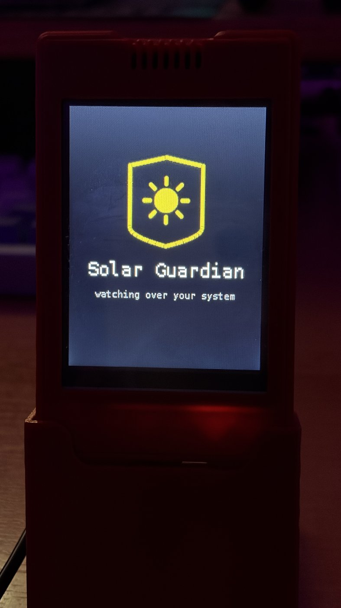
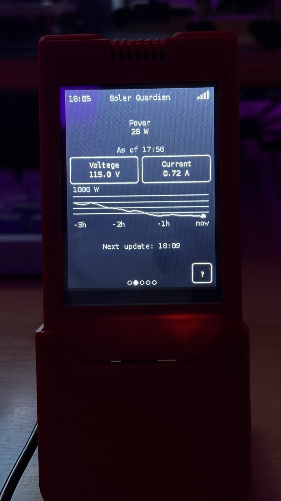
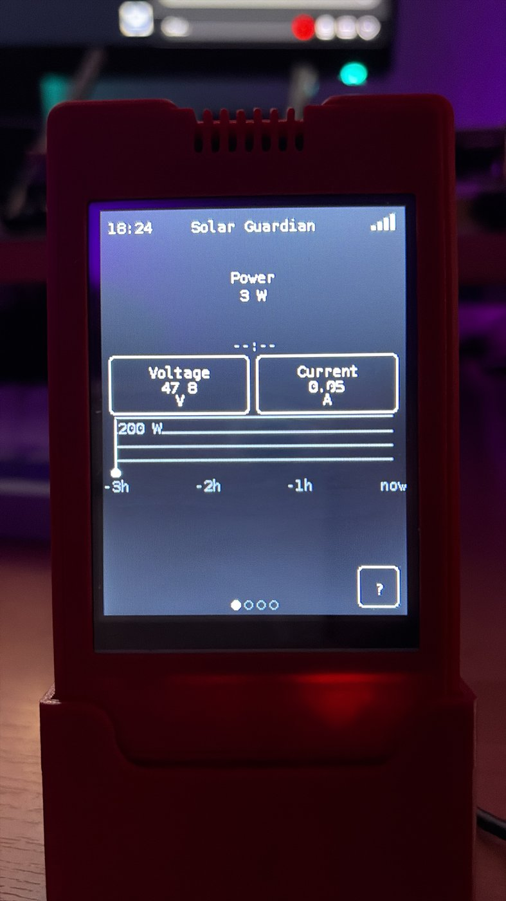
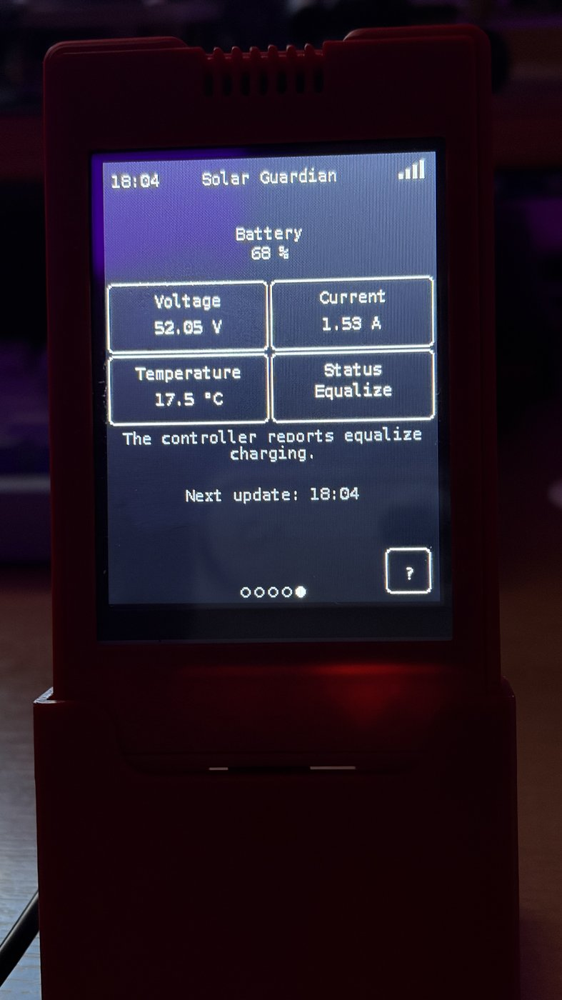
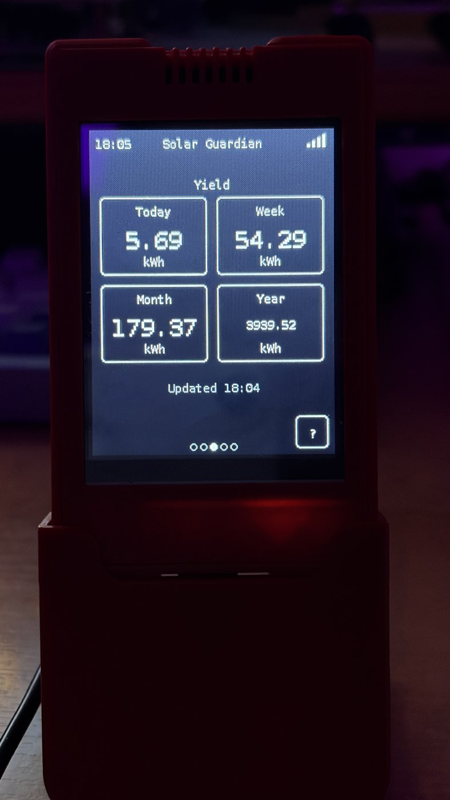
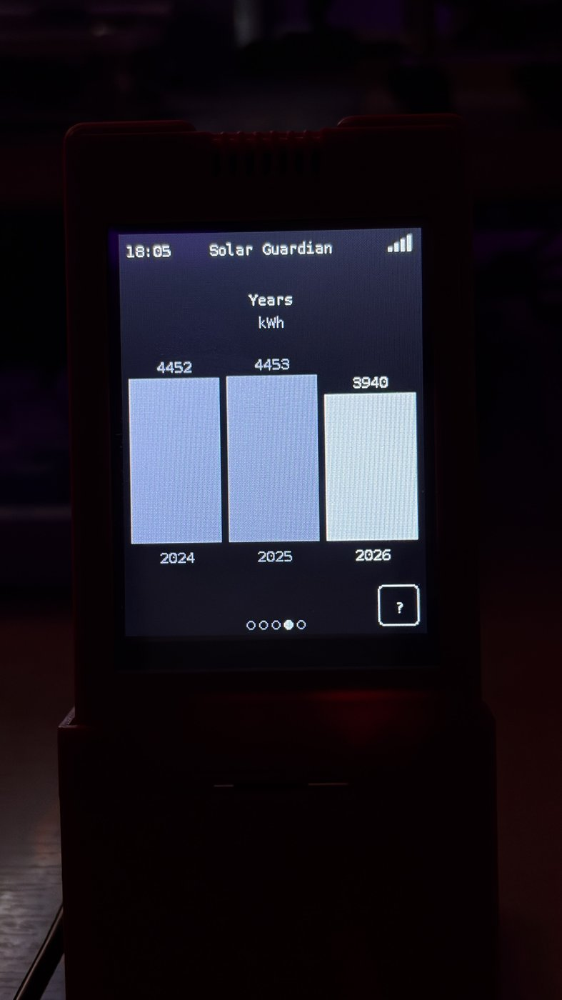
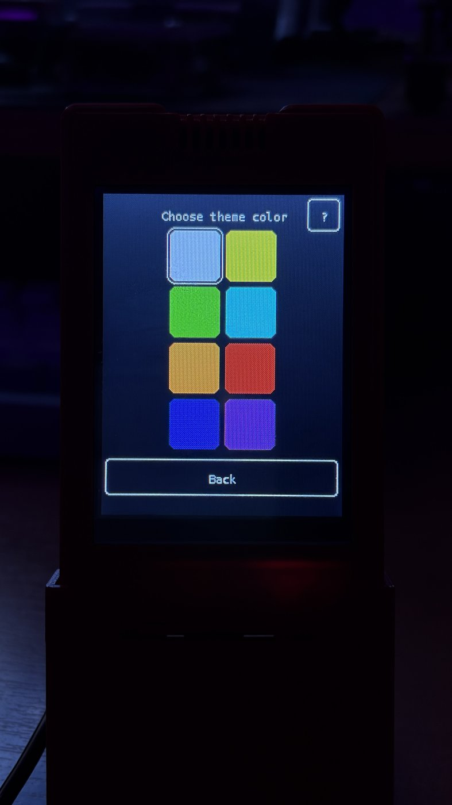
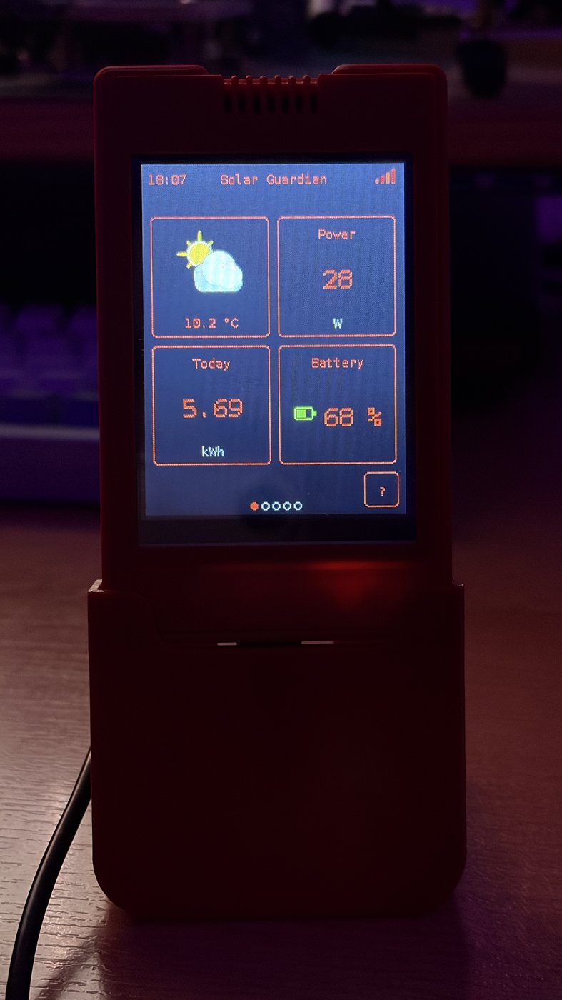

# 📷 Photo Gallery

A few more photos of Solar Guardian CYD in action.

[← Back to README](../README.md)

---

**Overview** – weather, current power, today's yield, and battery charge at a glance.

---

**Boot logo** – "sun in a shield", shown for 7 seconds on every start.

---

**Power** – current PV power, voltage/current, and a chart of the last 3 hours.

---

**Power** – another moment on the same page, with a live Watt reading.

---

**Battery** – charge level, voltage, current, temperature, and charging status.

---

**Yield** – today, this week (rolling 7 days), this month, and this year.

---

**Years** – a bar chart of the last calendar years, numbers never truncated.

---

**Menu** – Networks, Account, Theme color, Brightness, Language, Yield values, Files, Factory reset.

---

**Theme color** – pick the accent color used system-wide.

---

**Overview**, shown here in a different theme color.
