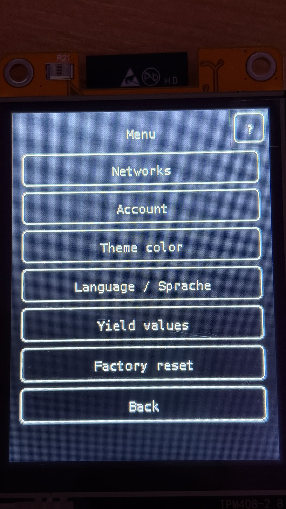
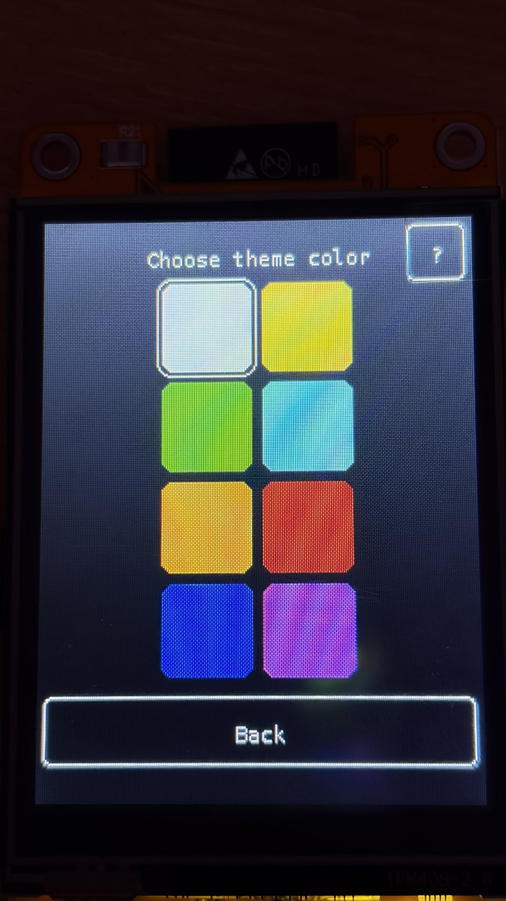
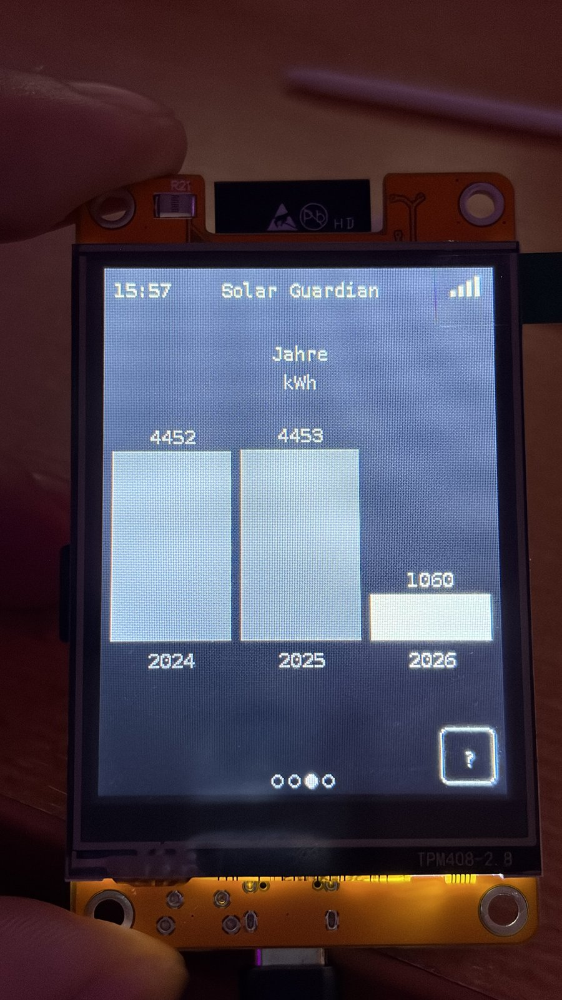
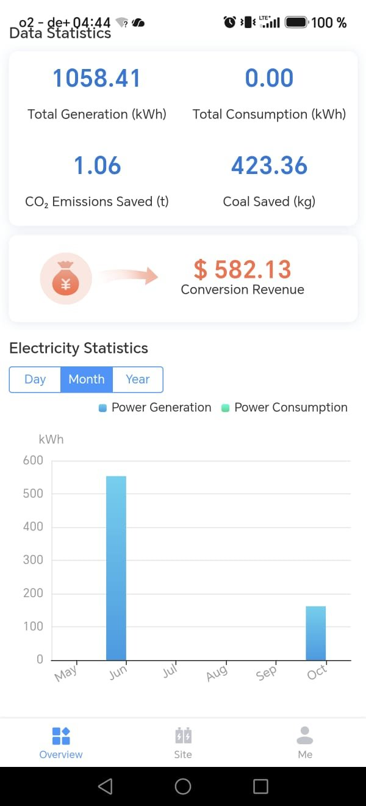
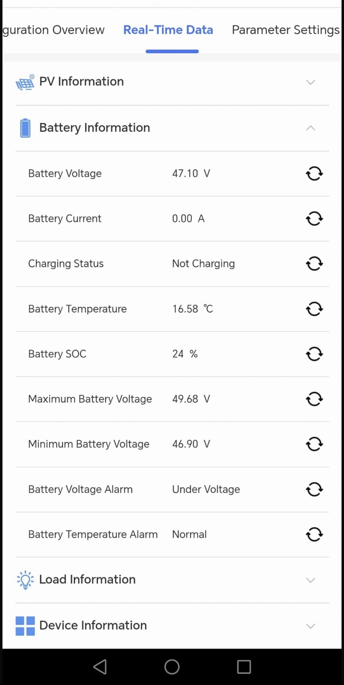
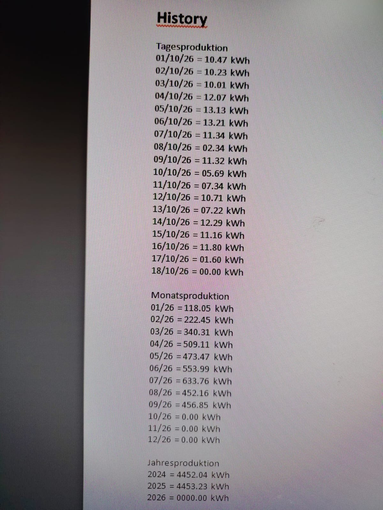

# 📷 Photo Gallery

A few more photos of Solar Guardian CYD in action.

[← Back to README](../README.md)

---

**Yield** – today, this week (rolling 7 days), this month, and this year.

---

**Menu** – Networks, Account, Theme color, Language, Yield values, Factory reset.

---

**Theme color** – pick the accent color used system-wide.

---

**Years** – a bar chart of the last calendar years, numbers never truncated.

---

**Solar Guardian portal** – the official app's overview screen, for comparison.

---

**Portal battery detail** – the live battery data this device reads from the same account.

---

**History table** – the portal's own daily/monthly/yearly table, used to validate the device's yield log against the source.
