# 📷 Photo Gallery

A few more photos of Solar Guardian CYD in action.

[← Back to README](../README.md)

---

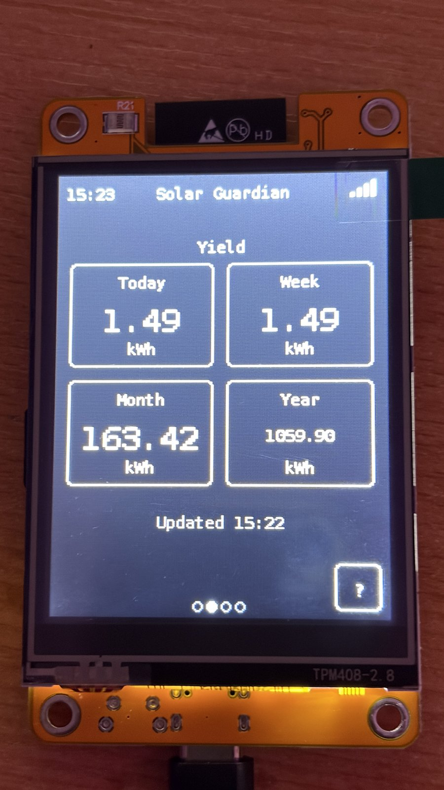
**Overview** – weather, current power, today's yield, and battery charge at a glance.

---

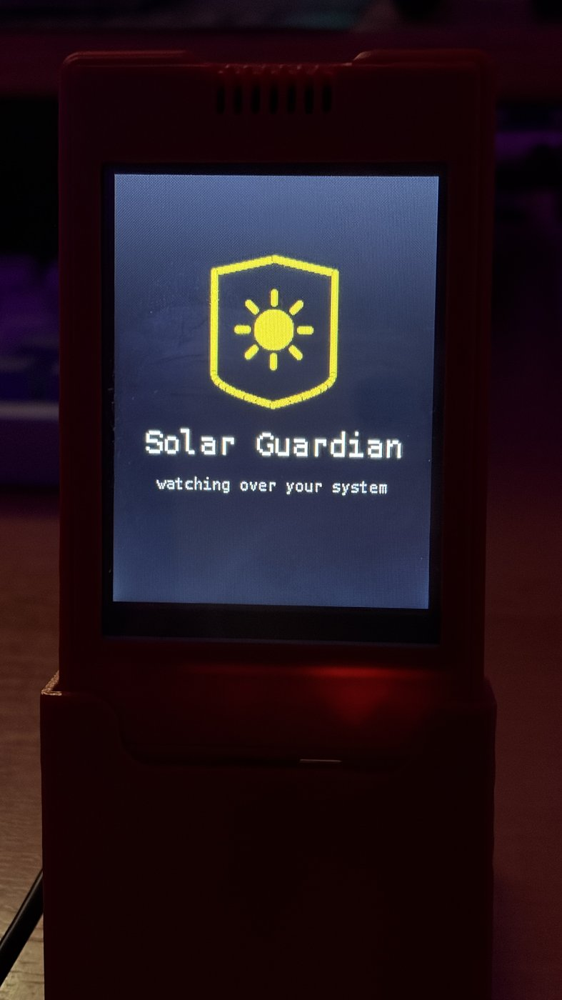
**Boot logo** – "sun in a shield", shown for 7 seconds on every start.

---

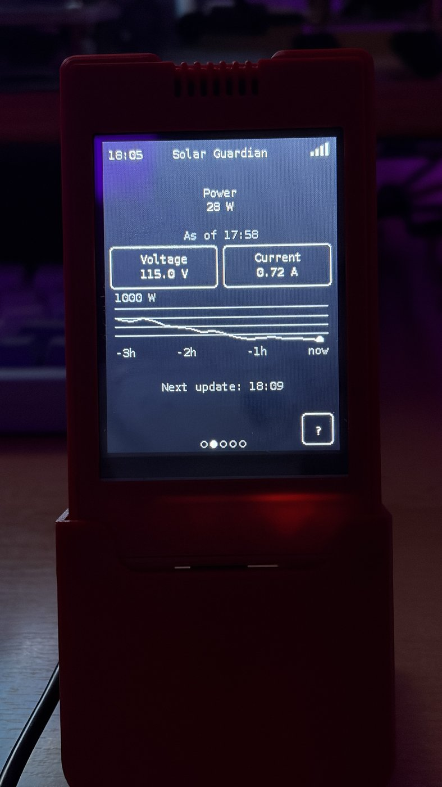
**Power** – current PV power, voltage/current, and a chart of the last 3 hours.

---

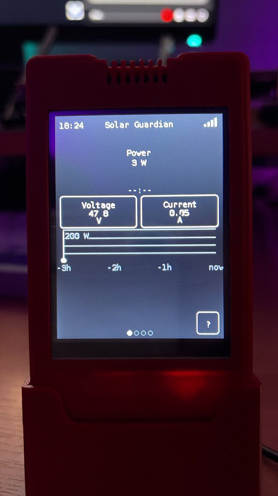
**Power** – another moment on the same page, with a live Watt reading.

---

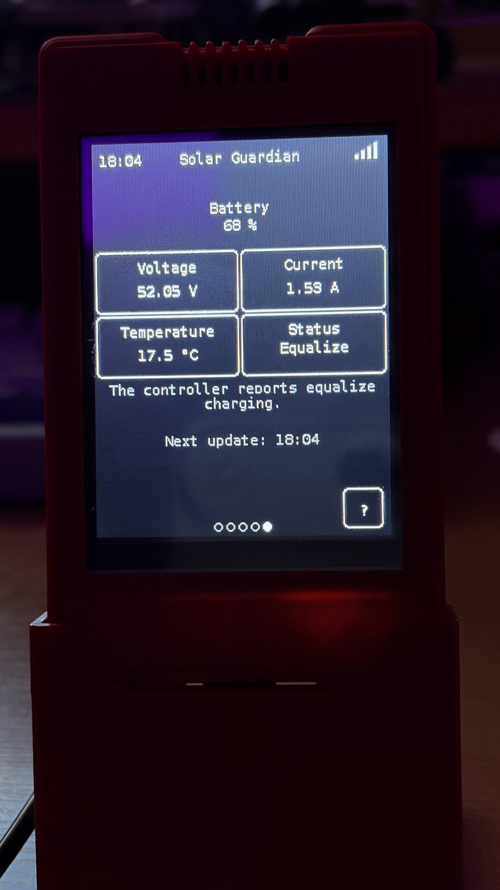
**Battery** – charge level, voltage, current, temperature, and charging status.

---

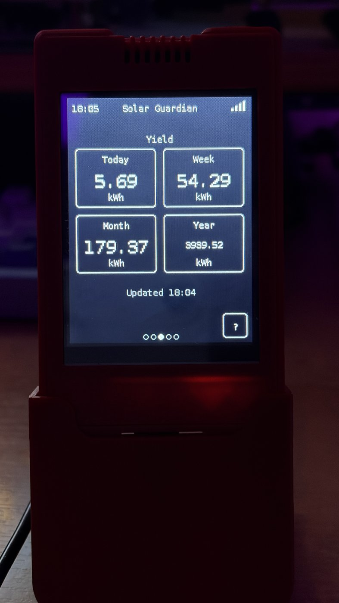
**Yield** – today, this week (rolling 7 days), this month, and this year.

---

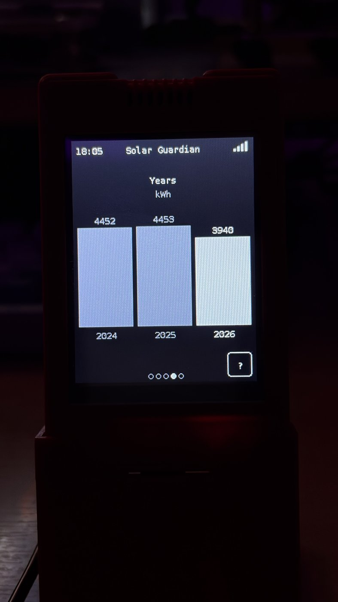
**Years** – a bar chart of the last calendar years, numbers never truncated.

---

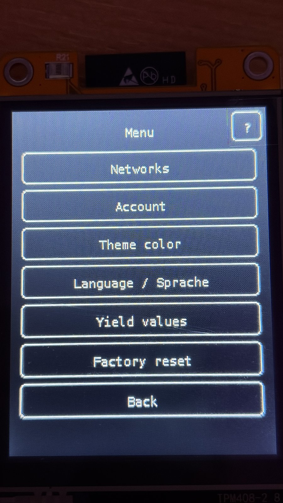
**Menu** – Networks, Account, Theme color, Brightness, Language, Yield values, Files, Factory reset.

---

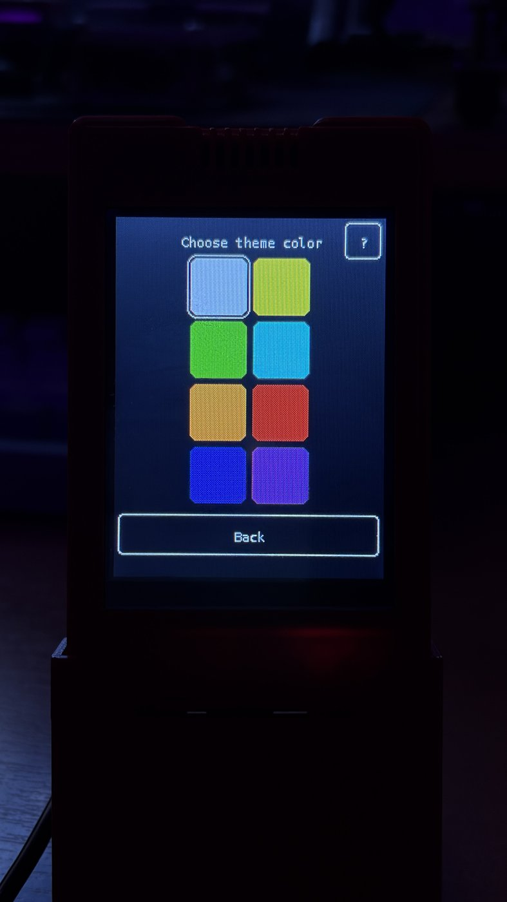
**Theme color** – pick the accent color used system-wide.

---

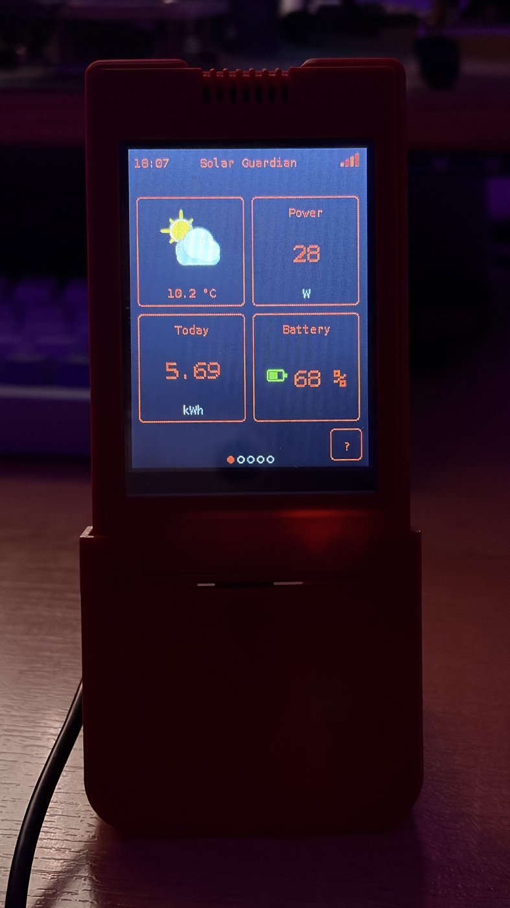
**Overview**, shown here in a different theme color.

---

## Web view

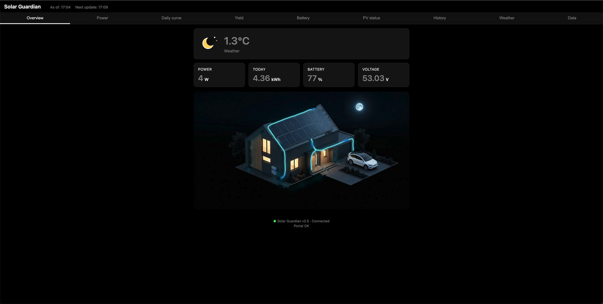
**Overview** – weather, power, today's yield, and battery voltage, with the animated house graphic below.

---

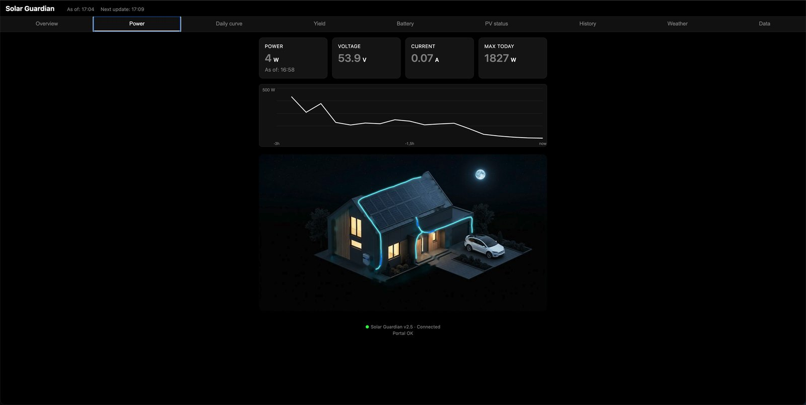
**Power** – current power, voltage, current, today's peak, and a chart of the last 3 hours.

---

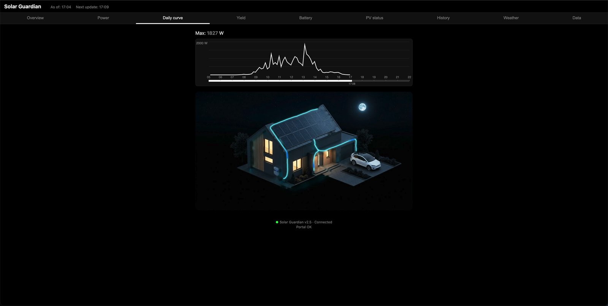
**Daily curve** – the power curve of the whole day, with a progress bar below the hourly axis.

---

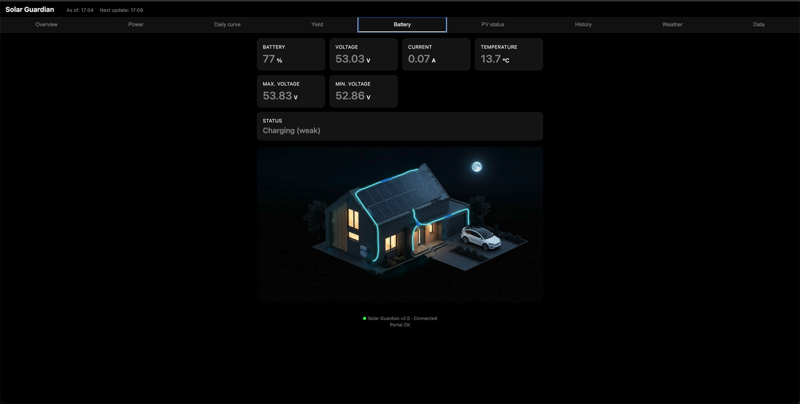
**Battery** – charge level, voltage, current, temperature, and the day's voltage range.

---

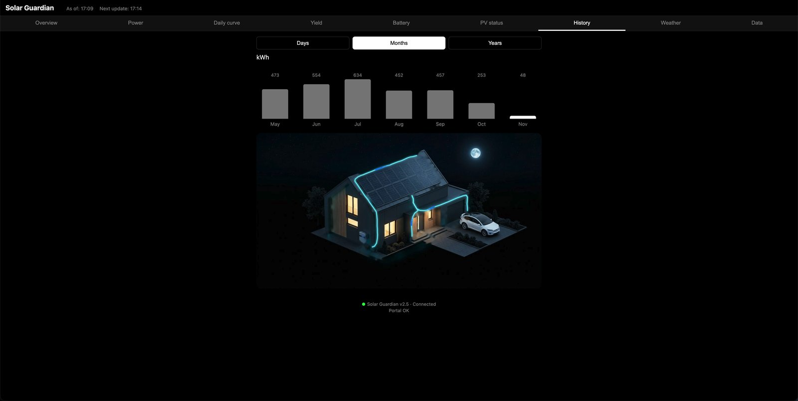
**History** – a bar chart of the last months, one of three tabs alongside days and years.

---

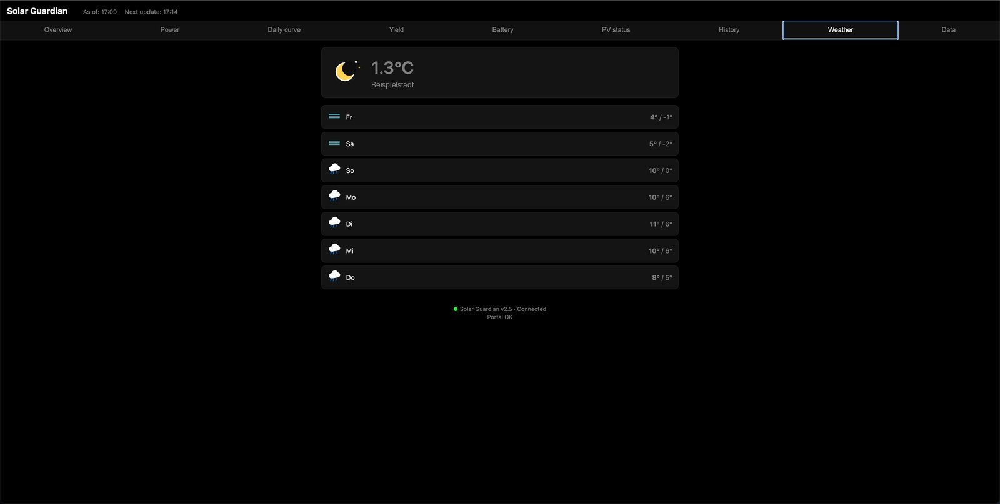
**Weather** – a week-ahead forecast with weekday, icon, and high/low temperature per day.
